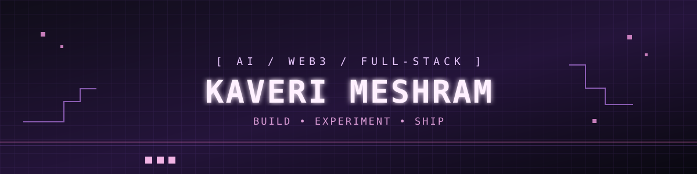

<!-- Retro terminal-inspired GitHub profile -->

<div align="center">



### `> hello_world();`

**AI + Web3 Developer · Full-Stack Builder · Hackathon Enthusiast**

I build products where intelligent systems meet decentralized technology.  
Currently exploring AI agents, blockchain infrastructure, and thoughtful developer experiences.

[](https://github.com/kaverimeshram)

</div>

---

## `01 / about_me`

```text
┌─────────────────────────────────────────────────────────────┐
│  WHOAMI                                                     │
├─────────────────────────────────────────────────────────────┤
│  name       : Kaveri Meshram                                │
│  focus      : AI • Web3 • Full-Stack Development            │
│  interests  : Agents, Blockchain, Open Source, Hackathons    │
│  mindset    : Learn → Build → Ship → Repeat                  │
│  status     : Always building something                     │
└─────────────────────────────────────────────────────────────┘
```

- Building AI-powered applications and agent workflows.
- Exploring smart contracts, on-chain systems, and Web3 infrastructure.
- Learning by shipping projects and collaborating at hackathons.

## `02 / tech_stack`

<div align="center">


</div>

## `03 / selected_builds`

| Project | What I'm building |
| --- | --- |
| [Hunch](https://github.com/kaverimeshram/hunch) | Evidence-focused product development |
| [TerraLens](https://github.com/kaverimeshram/terralens) | Satellite and spatial intelligence |
| [PlantLensAI](https://github.com/kaverimeshram/PlantLensAI) | AI-powered plant identification and diagnosis |
| [Kept](https://github.com/kaverimeshram/kept) | Social trading accountability |
| [PACT](https://github.com/kaverimeshram/pact) | Persistent commitments and reputation for agents |
| [Warden](https://github.com/kaverimeshram/Warden-) | Autonomous treasury agent |
| [feeMON](https://github.com/kaverimeshram/FeeMon-) | Liquid staking on Monad |
| [GroupPot](https://github.com/kaverimeshram/Grouppot) | Group-based savings concept |
| [Hermes Agent](https://github.com/kaverimeshram/hermes-agent) | Agent-focused experimentation |
| [Recover](https://github.com/kaverimeshram/Recover) | Current project repository |

## `04 / github_activity`

<div align="center">


</div>

## `05 / currently`

```bash
$ focus --now
> building AI + Web3 projects
> exploring autonomous agents
> learning Rust and smart contract development
> participating in hackathons
```

<div align="center">

<sub>━━━━━━━━━━━━━━━━━━━━━━━━━━━━━━━━━━━━━━━━━━━━━━━━━━━━━━━━━━━━━━━━</sub>

<sub>「 stay curious. keep building. 」</sub>

</div>
