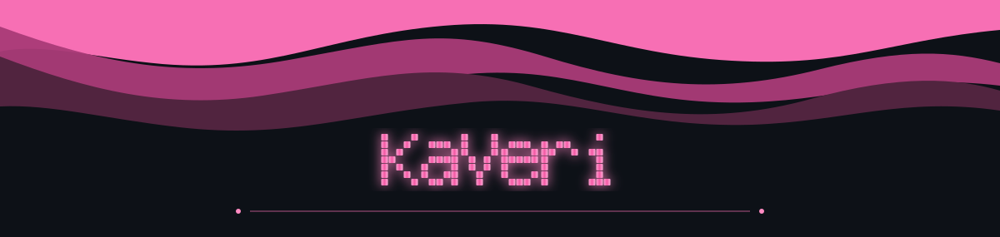
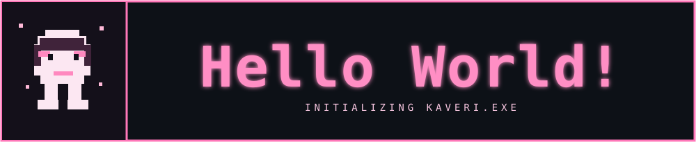

<!--
  Kaveri Meshram | GitHub profile README
  Visual direction: dark graphite + rose pink + pixel terminal
-->

<div align="center">



<br/>



<br/>

<sub><b>● system online — welcome_</b></sub>

</div>

<br/>

<div align="center">

</div>

## whoami

I'm **Kaveri Meshram** - a full-stack developer, AI builder, and Web3 enthusiast. I build scalable products, explore agentic systems, and participate in hackathons. I enjoy turning ideas into real-world applications, experimenting with new tools, and learning in public.

<br/>

<div align="center">

</div>

## tech stack

<div align="center">


</div>

<br/>

<div align="center">

</div>

## featured projects

<div align="center">

| Project | What I'm building |
|:--:|:--|
| **[EvolveX](https://github.com/kaverimeshram/Evolvex)** | Autonomous intelligence and continuous evolution |
| **[KeptCalls](https://github.com/kaverimeshram/kept)** | Social trading with on-chain accountability |
| **[TerraLens](https://github.com/kaverimeshram/terralens)** | Satellite and spatial intelligence |
| **[Hunch](https://github.com/kaverimeshram/hunch)** | Evidence-focused product development |
| **[PlantLens AI](https://github.com/kaverimeshram/PlantLensAI)** | AI-powered plant identification and diagnosis |
| **[PACT](https://github.com/kaverimeshram/pact)** | Persistent commitments and reputation for agents |
| **[Warden](https://github.com/kaverimeshram/Warden-)** | Autonomous treasury agent |
| **[feeMON](https://github.com/kaverimeshram/FeeMon-)** | Liquid staking on Monad |

</div>

## currently

<div align="center">

```text
> building AI + Web3 products
> exploring autonomous agents and on-chain systems
> learning Rust and smart contract development
> joining hackathons and open-source projects
```

</div>

<div align="center">

[](https://x.com/_kavericodes)
[](https://www.linkedin.com/in/kaveri-meshram/)

<br/>

<sub><b>✦ stay curious · keep building · ship often ✦</b></sub>

</div>
