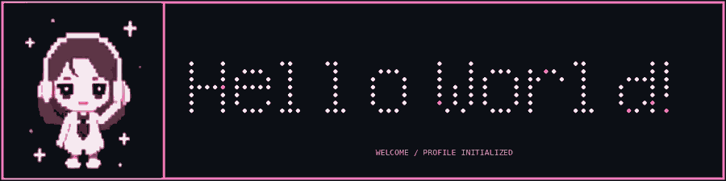

<!-- Layout matched to the supplied profile reference -->

<samp>Full-Stack Developer · AI Builder · Web3 Explorer</samp>

 

<samp><b>● system online — welcome_</b></samp>

 

<samp>I'm Kaveri Meshram - a full-stack developer, AI builder, and Web3 enthusiast. I build scalable products, explore agentic systems, and participate in hackathons. Currently focused on turning ideas into real-world, open-source projects.</samp>

 

&nbsp;JavaScript&nbsp;&nbsp;&nbsp;Python&nbsp;&nbsp;&nbsp;TypeScript&nbsp;&nbsp;&nbsp;Rust&nbsp;&nbsp;&nbsp;Solidity&nbsp;&nbsp;&nbsp;React&nbsp;&nbsp;&nbsp;Next.js&nbsp;&nbsp;&nbsp;Tailwind&nbsp;&nbsp;&nbsp;Node.js&nbsp;&nbsp;&nbsp;Vite

&nbsp;PostgreSQL&nbsp;&nbsp;&nbsp;MongoDB&nbsp;&nbsp;&nbsp;Prisma&nbsp;&nbsp;&nbsp;Docker&nbsp;&nbsp;&nbsp;FastAPI&nbsp;&nbsp;&nbsp;Express&nbsp;&nbsp;&nbsp;Expo&nbsp;&nbsp;&nbsp;Bun&nbsp;&nbsp;&nbsp;Cloudflare&nbsp;&nbsp;&nbsp;Git

&nbsp;LangChain&nbsp;&nbsp;&nbsp;OpenAI&nbsp;&nbsp;&nbsp;Gemini&nbsp;&nbsp;&nbsp;Groq&nbsp;&nbsp;&nbsp;GitHub&nbsp;&nbsp;&nbsp;NumPy&nbsp;&nbsp;&nbsp;Pandas&nbsp;&nbsp;&nbsp;scikit-learn&nbsp;&nbsp;&nbsp;Vercel&nbsp;&nbsp;&nbsp;Foundry

