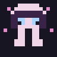

<!-- Profile README: retro terminal / pixel-art layout -->

<div align="center">

# Kaveri Meshram

**Full-Stack Developer · AI Builder · Web3 Explorer**

<br/>

<table>
  <tr>
    <td align="center" width="116">
      
    </td>
    <td align="center">
      <pre>
 _   _      _ _        __        __         _     _ _
| | | | ___| | | ___   \ \      / /__  _ __| | __| |
| |_| |/ _ \ | |/ _ \   \ \ /\ / / _ \| '__| |/ _` |
|  _  |  __/ | | (_) |   \ V  V / (_) | |  | | (_| |
|_| |_|\___|_|_|\___/     \_/\_/ \___/|_|  |_|\__,_|
      </pre>
    </td>
  </tr>
</table>

<sub>✦ system online — welcome_ ✦</sub>

</div>

---

## whoami

I'm Kaveri Meshram - a full-stack developer interested in AI, blockchain, and building useful products. I enjoy turning ideas into working applications, experimenting with new technologies, and learning by shipping projects.

Currently exploring **AI agents, Web3 infrastructure, smart contracts, and open-source development**.

---

## tech stack

<div align="center">


</div>

---

## featured projects

| Project | What it does |
| --- | --- |
| [Hunch](https://github.com/kaverimeshram/hunch) | Evidence-focused product development |
| [TerraLens](https://github.com/kaverimeshram/terralens) | Satellite imagery and spatial intelligence |
| [PlantLens AI](https://github.com/kaverimeshram/PlantLensAI) | AI-powered plant identification and diagnosis |
| [Kept](https://github.com/kaverimeshram/kept) | Social trading accountability |
| [PACT](https://github.com/kaverimeshram/pact) | Commitments and reputation for AI agents |
| [Warden](https://github.com/kaverimeshram/Warden-) | Autonomous treasury agent |
| [feeMON](https://github.com/kaverimeshram/FeeMon-) | Liquid staking concept on Monad |

---

## currently

```text
> building AI + Web3 projects
> exploring autonomous agents
> learning Rust and smart contract development
> participating in hackathons and open source
```

---

<div align="center">

[](https://x.com/_kavericodes)
[](https://www.linkedin.com/in/kaveri-meshram/)

<sub>✦ stay curious · keep building · ship often ✦</sub>

</div>
