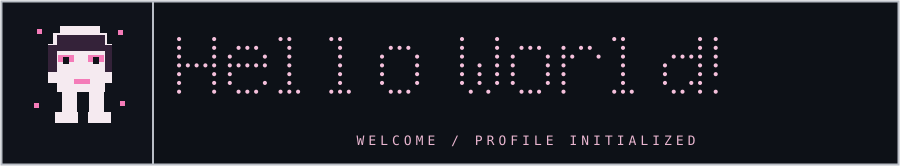
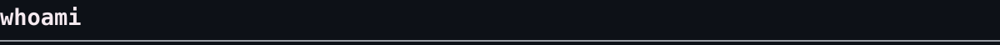

<!-- Exact reference-inspired layout: pink wave, pixel title, Hello World, whoami, three logo rows -->

 

 

<b>● system online — welcome_</b>

 

<samp>I'm Kaveri Meshram - a full-stack developer, AI builder, and Web3 enthusiast. I build scalable products, explore agentic systems, and participate in hackathons. I enjoy turning ideas into real-world applications, experimenting with new technologies, and learning in public.</samp>

 

&nbsp;JavaScript&nbsp;&nbsp;&nbsp;&nbsp;&nbsp;Python&nbsp;&nbsp;&nbsp;&nbsp;&nbsp;TypeScript&nbsp;&nbsp;&nbsp;&nbsp;&nbsp;Rust&nbsp;&nbsp;&nbsp;&nbsp;&nbsp;Solidity&nbsp;&nbsp;&nbsp;&nbsp;&nbsp;React&nbsp;&nbsp;&nbsp;&nbsp;&nbsp;Next.js

&nbsp;Node.js&nbsp;&nbsp;&nbsp;&nbsp;&nbsp;Express&nbsp;&nbsp;&nbsp;&nbsp;&nbsp;FastAPI&nbsp;&nbsp;&nbsp;&nbsp;&nbsp;PostgreSQL&nbsp;&nbsp;&nbsp;&nbsp;&nbsp;Prisma&nbsp;&nbsp;&nbsp;&nbsp;&nbsp;MongoDB&nbsp;&nbsp;&nbsp;&nbsp;&nbsp;Docker

&nbsp;Git&nbsp;&nbsp;&nbsp;&nbsp;&nbsp;GitHub&nbsp;&nbsp;&nbsp;&nbsp;&nbsp;OpenAI&nbsp;&nbsp;&nbsp;&nbsp;&nbsp;Cloudflare&nbsp;&nbsp;&nbsp;&nbsp;&nbsp;Vite&nbsp;&nbsp;&nbsp;&nbsp;&nbsp;Tailwind

 

## featured projects

| Project | Description |
| --- | --- |
| [EvolveX](https://github.com/kaverimeshram/Evolvex) | Autonomous intelligence and continuous evolution |
| [KeptCalls](https://github.com/kaverimeshram/kept) | Social trading with on-chain accountability |
| [TerraLens](https://github.com/kaverimeshram/terralens) | Satellite and spatial intelligence |
| [Hunch](https://github.com/kaverimeshram/hunch) | Evidence-focused product development |
| [PlantLens AI](https://github.com/kaverimeshram/PlantLensAI) | AI-powered plant identification and diagnosis |
| [PACT](https://github.com/kaverimeshram/pact) | Persistent commitments and reputation for agents |
| [Warden](https://github.com/kaverimeshram/Warden-) | Autonomous treasury agent |
| [feeMON](https://github.com/kaverimeshram/FeeMon-) | Liquid staking on Monad |

✦ stay curious · keep building · ship often ✦

