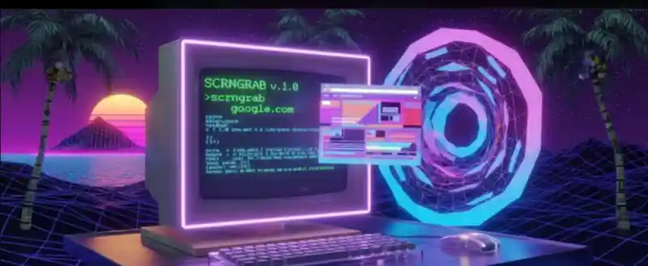

<!-- Retro / pixel terminal-inspired profile README -->

<div align="center">



# Kaveri

**Full-Stack Developer · AI & Web3 Builder**

<br/>

<table>
  <tr>
    <td align="center" width="110">
      
    </td>
    <td>
      <pre>
 _   _      _ _        __        __         _     _ _
| | | | ___| | | ___   \ \      / /__  _ __| | __| |
| |_| |/ _ \ | |/ _ \   \ \ /\ / / _ \| '__| |/ _` |
|  _  |  __/ | | (_) |   \ V  V / (_) | |  | | (_| |
|_| |_|\___|_|_|\___/     \_/\_/ \___/|_|  |_|\__,_|
      </pre>
    </td>
  </tr>
</table>

<sub>✦ system online — welcome ✦</sub>

</div>

---

## whoami

I'm Kaveri, a developer interested in building full-stack products, AI-powered applications, and Web3 systems. I enjoy taking ideas from a rough concept to a working product, experimenting with new technologies, and learning by building.

Currently exploring **AI agents, blockchain infrastructure, smart contracts, and developer tools**.

---

## tech stack

<div align="center">


</div>

---

## things i've built

| Project | Description |
| --- | --- |
| [Hunch](https://github.com/kaverimeshram/hunch) | Evidence-focused product development |
| [TerraLens](https://github.com/kaverimeshram/terralens) | Satellite and spatial intelligence |
| [PlantLens AI](https://github.com/kaverimeshram/PlantLensAI) | AI-powered plant identification and diagnosis |
| [Kept](https://github.com/kaverimeshram/kept) | Social trading accountability |
| [PACT](https://github.com/kaverimeshram/pact) | Persistent commitments and reputation for agents |
| [Warden](https://github.com/kaverimeshram/Warden-) | Autonomous treasury agent |
| [feeMON](https://github.com/kaverimeshram/FeeMon-) | Liquid staking on Monad |

---

## currently

```text
> building AI + Web3 projects
> experimenting with autonomous agents
> learning Rust and smart contract development
> joining hackathons and open-source projects
```

---

<div align="center">
  <sub>made with curiosity, late nights, and a terminal window ✦</sub>
</div>
